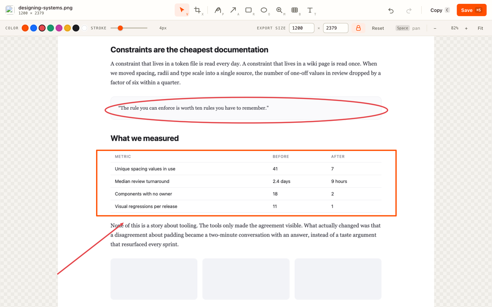
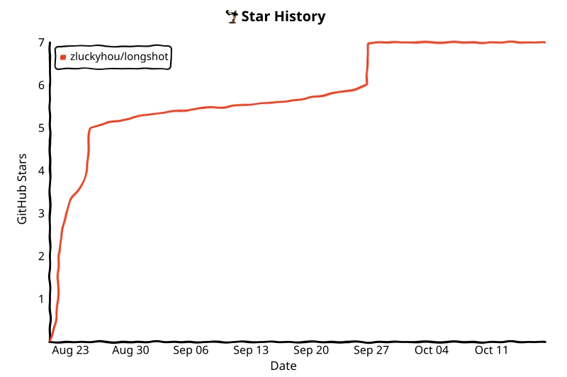

<div align="center">


# Longshot

**One click, the whole page.** Capture a full-page scrolling screenshot in Chrome,
then crop, annotate, mask, magnify, save, or copy it. Nothing leaves the machine.

[](https://github.com/zluckyhou/longshot/actions/workflows/validate.yml)
[](LICENSE)
[](PRIVACY.md)
[](https://chromewebstore.google.com/detail/longshot-%E2%80%94-scrolling-scre/kkpnodmddhpdleianjpjdjommjaikgbg)

<a href="https://ko-fi.com/J3J3YMOKZ"></a>

</div>



## Install

[Install Longshot from the Chrome Web Store](https://chromewebstore.google.com/detail/longshot-%E2%80%94-scrolling-scre/kkpnodmddhpdleianjpjdjommjaikgbg).

### Development install (unpacked)

1. Open `chrome://extensions`
2. Turn on **Developer mode**
3. **Load unpacked** → select this folder
4. Pin Longshot, open any page, click it — or press <kbd>Alt</kbd>+<kbd>Shift</kbd>+<kbd>S</kbd>

Requires Chrome 116+ (`chrome.runtime.getContexts`).

## Language

The UI follows the browser's language: Simplified Chinese gets `zh_CN`, everything
else falls back to English (`_locales/en` is `default_locale`). Nothing to
configure.

## How a capture works

```
popup ──LS_START──▶ background (service worker)
                      │
                      ├── scripting.executeScript ──▶ content.js
                      │      find what scrolls, unpin sticky, hide fixed, step it
                      │
                      ├── tabs.captureVisibleTab  ── one PNG per screen
                      │
                      ├── runtime.sendMessage ────▶ offscreen.js
                      │      draw each segment at its true scroll offset
                      │      canvas.toBlob → blob: URL
                      │
                      └── tabs.create ────────────▶ editor.html
```

Four details carry most of the quality:

- **The document is not always what scrolls.** SPAs, mail clients and dashboards
  routinely pin `<body>` and scroll an inner container; `window.scrollTo` does
  nothing there, which reads to the user as "it only captured what I could see".
  Longshot uses the document when it genuinely scrolls, and otherwise drives the
  scrollable element that dominates the viewport, cropping each screen to that
  element's rectangle.
- **Segments are drawn at their real scroll offset**, not appended end to end. The
  final screen usually overlaps the previous one (the page can't scroll past its
  bottom); painting by offset makes that overlap self-correcting instead of a bug.
- **`position: sticky` is demoted to `static`** for the run, so a sticky nav appears
  once where it belongs in the flow rather than riding down the whole image.
- **`position: fixed` chrome is kept for screen 1 and hidden afterwards**, so a
  floating header shows up once instead of being stamped on every screen.

Stitching happens in an offscreen document because a service worker has no canvas
and can't mint `blob:` URLs. Segments are drawn as they arrive and freed
immediately, so memory stays flat regardless of page length.

## Settings

| Setting | Default | Notes |
|---|---|---|
| Format | PNG | JPEG exposes a quality slider |
| Wait per screen | 220 ms | Time each screen gets to finish drawing before it is captured. Raise it on animated or slow pages, lower it to go faster. |
| Fixed headers once | on | Off = fixed chrome on every screen |
| Unpin sticky elements | on | Off = sticky bars repeat |
| Pre-scroll lazy images | on | Slower, but nothing renders blank |
| When done | Open editor | Or save the file straight to `Downloads/Longshot/` |

## Colours

The palette is FixedShot's Zapier theme, ported value for value from
`FixedShot/Sources/FixedShot/DesignTokens.swift` — accent `#FF4F00` on canvas
`#FFFEFB`, ink `#201515`, surface `#F8F4F0`, radii 12/12/6. The editor's ink
swatches are FixedShot's eight presets in the same order, so an annotation drawn
in one tool matches one drawn in the other, and the two app icons are siblings:
accent tile, cream stroke-only glyph, round caps.

## The editor

Captures open in a tab instead of landing in Downloads. Nothing is written to disk
until you ask for it.

| Key | Tool | | Key | Action |
|---|---|---|---|---|
| `V` | Select / move / resize | | `C` or `⌘C` | Copy image to clipboard |
| `K` (`X` also works) | Crop | | `⌘S` | Save PNG |
| `P` | Draw | | `⌘Z` / `⌘⇧Z` | Undo / redo |
| `A` | Arrow | | `Delete` | Delete selection |
| `R` | Rectangle | | `Esc` | Deselect and return to Select |
| `O` | Ellipse | | `⌘0` / `⌘1` | Fit whole shot / fit width |
| `M` | Magnifier | | wheel, `Space`+drag | Scroll / pan the canvas |
| `B` | Mask (opaque / pixelate) | | `Shift`+draw | Constrain to a square/circle |
| `T` | Text | | `⌘`+wheel | Zoom |
| `L` | Line | | `Shift`+line/arrow | Constrain to 45° |
| `H` | Highlight | | `⌘D` | Duplicate selection |
| `N` | Number (auto increment) | | Arrow keys / `Shift`+arrows | Move selection 1 / 10 screen pixels |

A capture opens whole. When it is taller than the window that makes it a thin
strip, so a **zoom-in** pill sits in the middle of it: one click takes the shot
to the window's width, top first, to read down with the wheel; the pill then
moves to the corner as **fit all** to go back. The button at the right of the
sub-bar does the same, and every control shows its shortcut.

**Magnifier** redraws original-resolution pixels and earlier annotations directly
at the lens resolution, instead of enlarging an already downsampled preview.
Existing masks remain masked inside the lens; other lenses are not recursively
magnified. Drawing the initial circle sets its area at the chosen power. After
creation, dragging its edge keeps the sampled area fixed: a larger lens also
increases magnification. The slider independently adjusts power from 1.1× to
12×. Pixels are interpolated when shrinking and kept sharp when enlarging;
zooming beyond the source resolution cannot create missing detail. Preview and
export use the same rendering path.

**Text** follows FixedShot's editing flow: click to type, Enter to finish,
Shift+Enter for a new line, Escape to cancel. Chinese IME confirmation stays in
the input. Double-click existing text to edit it again; drag the left or right
handle to change the wrapping width. Font size is independent of stroke width,
with bold and three plate styles (solid, outline, plain). Light ink gets a dark
plate automatically. New text starts at a readable 22 screen pixels even when a
long capture is zoomed out. The size control shows the current on-screen size;
zooming changes the preview, not the text's exported size.

**Selection** follows FixedShot: finishing a drawing leaves it unselected and
keeps the current drawing tool. Click an existing annotation to select, move or
resize it without switching tools first.

**Properties** follow the selected annotation. Lines, arrows, rectangles and
ellipses support solid or dashed strokes; highlights use FixedShot's dedicated
four-color palette. All ink tools also support custom colors. Number markers
increment automatically. Masks default to an opaque fill, with adjustable
pixelation as an alternative. Selected annotations can be duplicated, deleted,
or nudged with the keyboard.

**Undo / redo** covers text entry and re-editing, shape geometry, property changes,
and output dimensions. A slider drag is one step; selecting an annotation does
not erase redo, and undoing an annotation keeps the current zoom and pan.

**Export size** rescales the output without touching the annotations; the lock
keeps the aspect ratio. Unlocking it scales both dimensions independently.
**Crop** narrows what is exported and resets the size. Copy and save finish any
pending text before rendering. Annotation preview and PNG export use the same
layout and drawing code.

## Permissions

| Permission | Why |
|---|---|
| `activeTab` | Read + capture only the tab you explicitly invoke on. No host permissions, so Longshot cannot see any page you don't point it at. |
| `scripting` | Inject the measuring/scrolling script into that tab |
| `downloads` | Write the finished image, when you ask it to |
| `storage` | Remember your settings |
| `offscreen` | Host the stitching canvas |
| `clipboardWrite` | The editor's copy command |

## Known limits

- **Chrome throttles `captureVisibleTab`** to roughly two calls per second. Longshot
  captures at full speed and backs off only when Chrome refuses, but a very long
  page still takes a while.
- **The tab must stay in front.** `captureVisibleTab` reads whatever is visible, so
  switching tabs aborts the capture rather than producing a corrupted image.
- **One scroller.** The dominant scrollable region is captured; a page with two
  independently scrolling panes captures only the larger one.
- **Horizontal scroll isn't stitched** — output is the page at its current width.
- **Very tall pages get scaled down** to fit Chrome's canvas limits (32767 px per
  side, 2^28 px total). The popup says so when it happens.
- `chrome://`, the Web Store, and `file://` (without the file-access opt-in) are
  blocked by Chrome, not by Longshot.

## Layout

```
manifest.json
_locales/{en,zh_CN}/messages.json
src/
  background.js   run orchestration, capture, editor handoff, download
  content.js      scroller detection, measurement, sticky/fixed handling
  offscreen.js    canvas stitching, blob export
  editor.*        the annotation editor
  popup.*         the capture panel
  theme.css       shared tokens + bundled faces
  i18n.js
fonts/            Space Grotesk + JetBrains Mono, latin, OFL
icons/            generated by scripts/icon.mjs
```

Regenerate icons after changing the mark:

```bash
node scripts/icon.mjs
```

## Chrome Web Store package

Current upload version: **0.4.0**. Build from the workspace source:

```bash
node scripts/build-store.mjs
```

The package is written to `store/longshot-0.4.0.zip`, with `manifest.json` at the
archive root and only runtime assets included. Store text and release notes are
in `store/LISTING.md`. Creating this package does not upload or publish it.

## Privacy

Longshot has no server, account, analytics, or host permissions. Capture,
stitching, editing, and export happen locally in the browser. Read the full
policy in [English](PRIVACY.md) or [简体中文](PRIVACY.zh-CN.md).

## Star history

The chart is generated inside this repository by
[Star History Action](https://github.com/narayann7/star-history-action). It uses
the repository-scoped `GITHUB_TOKEN`; no personal access token or star data is
sent to a third-party chart service.

<!-- star-history:start -->
<picture>
  <source media="(prefers-color-scheme: dark)" srcset="docs/star-history/star-history-dark.svg">
  
</picture>
<!-- star-history:end -->

## License

Longshot is open source under the [MIT License](LICENSE).
